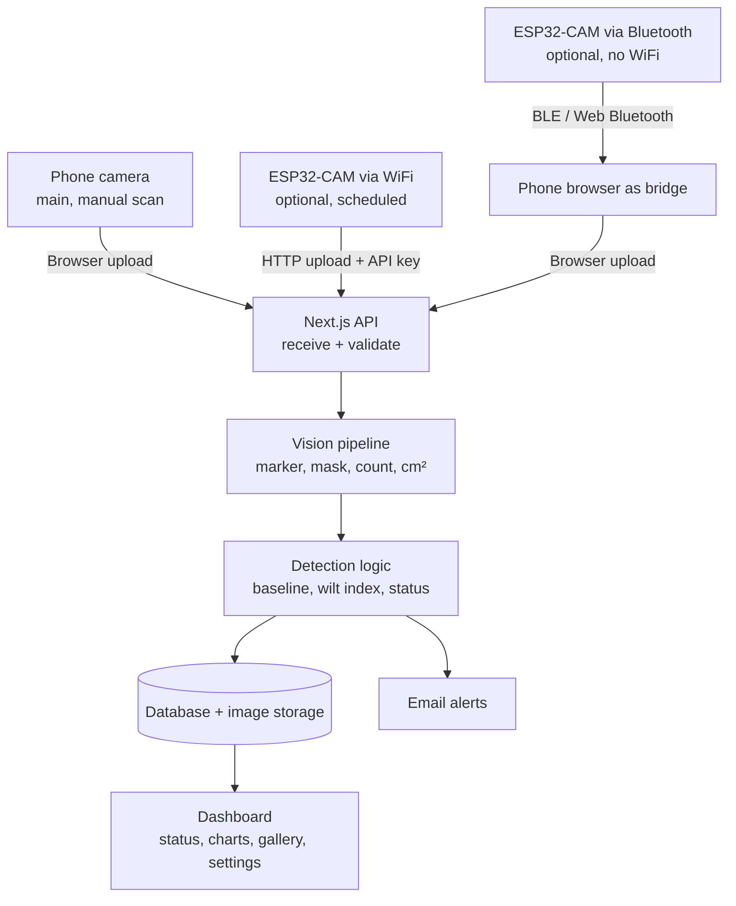

# Plant Wilting Detection System — Project Plan

> Image-based plant wilting detection using green pixel counting.
> **Main input:** phone camera through a Next.js web app.
> **Optional inputs:** ESP32-CAM over WiFi or Bluetooth (BLE).

---

## 1. Overview

### 1.1 Problem
Wilting is often noticed too late. By the time someone sees it, the plant is already stressed. Manual checking is also inconsistent and subjective.

### 1.2 Goal
Build a web-based system that:
- measures a plant's visible leaf area from photos,
- compares it against that same plant's healthy baseline,
- classifies the plant as **Healthy**, **Mild Wilting**, or **Wilting**,
- notifies the owner by email when wilting is detected.

### 1.3 Core principle
A well-watered plant holds its leaves open and spread out. When it loses water, the leaves droop, fold, and curl. Later they may yellow or brown. From a consistent camera view, this shows up as:
1. **Fewer green (leaf) pixels**, meaning a smaller projected leaf area.
2. **More yellow/brown pixels** within the plant area (discoloration).

The system does not "see" wilting directly. It tracks the change in visible leaf area over time, relative to the plant's own baseline.

### 1.4 Scope

| In scope | Out of scope |
|---|---|
| Wilting detection from leaf area change | Plant disease identification |
| Discoloration (yellow/brown) ratio | Plant species identification |
| One plant per capture | Measuring actual water content |
| Phone capture (main), ESP32-CAM (optional) | Automatic watering (future work) |
| Dashboard, history, email alerts | Native mobile app (web app / PWA only) |

### 1.5 Proposed success criteria
These are targets to confirm during validation.

| Metric | Target |
|---|---|
| Leaf area measurement error (paper cutout test) | ≤ 10% |
| Leaf area variation when camera distance changes | ≤ 5% |
| Wilting classification accuracy vs. human labels | ≥ 85% |
| Processing time per image (server) | < 2 seconds |
| Email alert after wilting is confirmed | < 1 minute |

---

## 2. System Architecture



Every input source goes through the same pipeline. Each capture is tagged with its `source` (`phone`, `esp32_wifi`, `esp32_ble`).

---

## 3. Tech Stack

| Layer | Choice | Notes |
|---|---|---|
| Framework | **Next.js** (App Router) | Pages, server components, server actions, and API route handlers |
| Language | TypeScript | Shared types between browser and server |
| UI | Tailwind CSS + shadcn/ui | Fast, mobile-friendly UI |
| Charts | Recharts | Leaf area / wilt index over time |
| Image prep (server) | **sharp** | Decode, rotate, resize, crop, raw pixels, overlay output |
| Pixel classification | **Own logic** (shared module) | HSV conversion + green / stressed / marker rules |
| Mask cleanup | **image-js** | Morphology (open/close), blob analysis, small-blob removal |
| Live preview (browser) | Canvas API | Same pixel rules as server, for instant feedback |
| Camera (browser) | Native camera input + live camera (getUserMedia) | Live camera requires HTTPS |
| QR scanning | Browser barcode detection or a QR library | Select a plant by scanning its pot label |
| Database | PostgreSQL (e.g., Supabase) | With an ORM such as Prisma or Drizzle |
| Image storage | Object storage (e.g., Supabase Storage, S3, Cloudinary) | Not the server filesystem |
| Auth | Supabase Auth or Auth.js | Owner account / small team |
| Email | Resend, or Nodemailer + Gmail App Password | Alerts and reminders |
| Scheduler | Vercel Cron Jobs (or any cron service) | Daily scan reminders, device offline checks |
| Hosting | Vercel | HTTPS by default, needed for camera and Web Bluetooth |
| Bluetooth (optional) | Web Bluetooth API | Chrome on Android, Edge, Samsung Internet; Bluefy on iPhone |
| Firmware (optional) | Arduino / ESP-IDF on ESP32-CAM | Later phases only |

**Runtime note:** route handlers that use sharp must run on the **Node.js runtime**, not Edge.

---

## 4. Physical Setup & Capture Protocol

Consistency matters more than camera quality. Every image of a plant must be taken under the same conditions.

### 4.1 Required items
- **Backdrop board:** matte white or light gray. Must not be green, and must not be blue (blue is reserved for the marker).
- **Reference marker card**, printed on matte paper:
  - a **5 × 5 cm solid blue square** (exact size, verified with a ruler after printing),
  - a **white patch** beside it, used for white balance correction,
  - optional: plant QR code on the same card.
- **Soil collar (optional, recommended):** a matte white or gray sheet with a slit, placed over the pot to hide the soil. Soil is brown and can be mistaken for discoloration.
- **Phone stand (optional):** a fixed-height top-down holder makes phone captures nearly as consistent as the ESP32.

### 4.2 Capture rules
1. **View:** top-down for leafy and rosette plants (lettuce, pechay). A side view is only for upright plants, and needs its own baseline.
2. **Marker placement:** next to the plant, **at leaf height** (on top of the pot rim or a small stand), fully visible.
3. **Lighting:** shade or indoor even light. No direct sun, no hard shadows, no flash.
4. **Time of day:** scan at roughly the same time each day (e.g., 7–9 AM), to avoid midday heat droop.
5. **One plant per photo.** Other plants must be out of frame.
6. **Framing:** match the ghost overlay of the baseline photo (see §7.2).

---

## 5. Image Processing Pipeline

The pipeline runs on the server for every upload; the server result is the official one. Steps 1–5 also run in the browser on a downscaled image, as a live preview.

All thresholds below are **starting values**. Tune them during calibration (Phase 3), and store them in the database, not in code.

### Step 1 — Prepare
- Apply EXIF orientation (phone photos are often rotated in metadata).
- Resize so the long edge is **1280 px** for phone photos; ESP32 images stay at their native size (VGA/SVGA).
- The browser already resizes phone photos before upload (long edge 1280 px, JPEG ~85%) to save data and time.

### Step 2 — Find the reference marker
- Classify pixels as **marker blue**: hue 200–250°, saturation ≥ 50%, brightness ≥ 25%.
- Take the largest connected blue blob.
- Validate it:
  - its aspect ratio is between 0.8 and 1.25,
  - its fill ratio (blob area ÷ bounding box area) is ≥ 0.85,
  - it covers at least 0.3% of the image.
- **If no valid marker is found, reject the image** and ask for a retake. For ESP32 sources, a marker is optional (see §10).
- Compute the scale: **`cm² per pixel = 25 cm² ÷ marker pixel count`**.

### Step 3 — White balance correction
- Locate the white patch next to the marker (a fixed offset from the marker, or the brightest low-saturation region beside it).
- Scale the R, G and B channels so that the patch becomes neutral gray.
- This reduces color shifts from different lighting and phone auto-white-balance.

### Step 4 — Region of interest
- **Phone:** the whole image minus the marker card area. The user can optionally adjust a crop box on the result screen if something else got in frame.
- **ESP32:** a fixed rectangle saved in the device settings.

### Step 5 — Pixel classification
Convert each pixel to HSV (hue 0–360°, saturation and value 0–100%), then classify:

| Class | Rule (starting values) |
|---|---|
| **Leaf (green)** | hue 70–170°, saturation ≥ 16%, value ≥ 16% |
| **Stressed (yellow/brown)** | hue 20–65°, saturation ≥ 25%, value ≥ 15% — counted only inside the plant region (Step 7) |
| **Marker** | handled in Step 2 |
| **Background** | everything else |

The classification rules live in **one shared module**, used by both the browser preview and the server. The preview then always matches the official result.

### Step 6 — Mask cleanup (image-js)
1. **Opening** (3×3) removes speckle noise.
2. **Closing** (5×5) fills small holes inside leaves.
3. **Small-blob removal** drops blobs smaller than 0.1% of the region of interest (moss, reflections, debris).
4. **Main plant selection** keeps the largest blob plus any blob within a set distance of it. This drops stray green objects far from the plant.

### Step 7 — Plant region for discoloration
- Build the **plant region**: the convex hull, or a dilated version, of the cleaned leaf mask.
- Count stressed pixels **only inside the plant region**, so that soil, the pot, and the table are not counted.

### Step 8 — Measure
| Metric | Formula |
|---|---|
| Leaf pixels | count of pixels in the cleaned leaf mask |
| Stressed pixels | count of stressed pixels inside the plant region |
| **Leaf area (cm²)** | leaf pixels × cm² per pixel |
| Coverage % | leaf pixels ÷ ROI pixels × 100 |
| **Discoloration %** | stressed ÷ (leaf + stressed) × 100 |
| Plant height px (side view only) | top-most to bottom-most leaf pixel |

### Step 9 — Quality checks
A capture is marked `rejected` (it is stored but not used for detection) if any of these hold:
- no valid marker (phone source),
- mean brightness is below 20% or above 90%,
- it is blurry: the sharpness score (edge strength) is below a threshold,
- the leaf area changed by more than 40% versus the last valid capture within 2 hours (likely a framing error, a hand, or an object in frame).

### Step 10 — Output overlay
- Draw the original image with leaf pixels tinted **green**, stressed pixels tinted **orange**, and the marker outlined.
- Save it as a JPEG next to the original. It is shown on the result screen and in the dashboard.

### Step 11 — Save
- Upload the original and the overlay to storage.
- Insert the capture row, with all metrics and a **settings snapshot** (the thresholds used), so old results stay reproducible after the thresholds change.

---

## 6. Wilting Detection Logic

### 6.1 Baseline
- **Initial calibration:** water the plant, wait about 1 hour, take **3 captures**, and use the **average leaf area (cm²)** as the baseline.
- **Rolling update (growth handling):** if the median of the last 3 *healthy* readings exceeds the baseline, raise the baseline to that median.
- The baseline **never decreases automatically**. After pruning or harvesting leaves, the user runs **Recalibrate**.
- Baselines are kept **per plant per source**. A phone baseline and an ESP32 baseline are only interchangeable when both use the marker (cm²).

### 6.2 Wilting index
**Wilting index % = (baseline leaf area − current leaf area) ÷ baseline leaf area × 100**

Negative values (growth) are clamped to 0 for status purposes, but stored as-is.

### 6.3 Status thresholds (starting values; calibrate per species)

| Wilting index | Status |
|---|---|
| < 10% | Healthy |
| 10% – 25% | Mild Wilting |
| ≥ 25% | Wilting |
| (no baseline / no valid captures) | Unknown |

**Discoloration flag:** if discoloration is ≥ 15%, show a "Discoloration detected" note alongside the status. It is reported separately and does not change the wilting status.

### 6.4 Smoothing & confirmation
- **Phone (manual):** if a scan returns Mild or Wilting, the app asks for **one confirmation retake**. The final status is the **lower** severity of the two (this avoids false alarms from one bad photo).
- **ESP32 (scheduled):** use the median of the last 3 valid readings. The status changes only after **2 consecutive** readings agree.

### 6.5 Temporary (midday) wilting
- For scheduled sources, readings between **11:00 and 15:00** that show wilting but recover by **17:00** are logged as **temporary wilting**. They appear on the chart but do not send an alert.
- For phone scans, the capture protocol (morning scans) avoids this.

### 6.6 Alert rules

| Event | Action |
|---|---|
| Status changes to **Wilting** | Email immediately: plant name, wilting %, leaf area, photo + overlay, link to plant page |
| Still Wilting after 6 hours | Reminder email (max 2 per day) |
| Wilting → Healthy | "Recovered" email |
| ESP32 has no upload for 2× its interval | "Device offline" email |
| Plant not scanned today by the reminder time | "Time to scan" reminder email |

---

## 7. Features & Screens

### 7.1 Dashboard (`/dashboard`)
- One card per plant, showing:
  - status badge,
  - wilting %,
  - leaf area (cm²),
  - last scan time,
  - source icon,
  - thumbnail.
- Filters: needs attention, all plants.
- Device status (online/offline) for ESP32 units.

### 7.2 Scan (`/scan`) — phone flow
1. **Select plant**: scan the QR label or pick from a list.
2. **Camera**:
   - live view with the **ghost overlay** (the baseline photo at ~30% opacity),
   - a **marker indicator** (turns green when the marker is detected),
   - a toggle for the live mask preview,
   - fallback: a native camera button (works without HTTPS during development).
3. **Preview**: the photo with its mask, an estimated leaf area, and quality warnings. Options: Retake or Submit.
4. **Result** (`/scan/result/[captureId]`): the official numbers, the status, and the overlay. If the status is Mild or Wilting, the app prompts the confirmation retake.

### 7.3 Plant detail (`/plants/[id]`)
- Line chart of leaf area (cm²) and wilting index over time, with:
  - threshold lines,
  - watering events (manual "I watered" button),
  - rejected captures shown as faded points.
- Gallery and timelapse of captures (original / overlay toggle).
- Baseline info, plus **Recalibrate** (`/plants/[id]/calibrate`).
- Per-plant threshold overrides.

### 7.4 Plants management
- Add, edit, and archive plants (name, species, location, camera view).
- Generate a **printable label**: QR code plus the marker card layout.

### 7.5 Devices (`/devices`) — optional phases
- Register an ESP32 and generate its API key (shown once).
- Settings: capture interval, frame size, ROI rectangle, LED on/off.
- Commands: **Capture now**, push settings.
- **Connect via Bluetooth** button (Web Bluetooth), which captures and uploads through the phone.
- Last seen time, firmware version, signal strength.

### 7.6 Settings (`/settings`)
- HSV ranges, with live preview sliders on a sample image.
- Status thresholds and the discoloration threshold.
- Alert recipients, daily reminder time, and alert toggles.

---

## 8. Data Model

### `plants`
| Field | Notes |
|---|---|
| id | |
| name, species, location | |
| camera_view | `top` / `side` |
| qr_code | value printed on the label |
| threshold_overrides | JSON, nullable |
| archived_at | nullable |
| created_at | |

### `baselines`
| Field | Notes |
|---|---|
| id, plant_id | |
| source | `phone` / `esp32_wifi` / `esp32_ble` |
| leaf_area_cm2 | nullable for marker-less ESP32 setups |
| leaf_pixels | used when there is no marker |
| type | `calibration` / `rolling` |
| sample_capture_ids | captures that formed this baseline |
| is_active | one active baseline per plant per source |
| created_at | |

### `captures`
| Field | Notes |
|---|---|
| id, plant_id, device_id (nullable) | |
| source | `phone` / `esp32_wifi` / `esp32_ble` |
| captured_at | |
| image_url, overlay_url | |
| width, height | |
| marker_found, marker_pixels, cm2_per_pixel | |
| leaf_pixels, stressed_pixels | |
| leaf_area_cm2, coverage_pct | |
| wilt_index_pct, discoloration_pct | |
| quality_status, quality_reason | `ok` / `rejected` + reason |
| status | `healthy` / `mild` / `wilting` / `unknown` |
| is_confirmation_of | capture id, for phone retakes |
| is_temporary_wilting | boolean |
| settings_snapshot | JSON of the thresholds used |

### `devices`
| Field | Notes |
|---|---|
| id, name, plant_id | |
| api_key_hash | the key is never stored in plain text |
| transport | `wifi` / `ble` |
| capture_interval_min, frame_size, roi | |
| last_seen_at, firmware_version, rssi | |

### `device_commands`
| Field | Notes |
|---|---|
| id, device_id | |
| type | `capture_now` / `update_settings` |
| payload | JSON |
| status | `pending` / `delivered` / `done` |
| created_at, delivered_at | |

### `watering_events`
| Field | Notes |
|---|---|
| id, plant_id, watered_at, note | Shown on the chart; used in validation |

### `alerts`
| Field | Notes |
|---|---|
| id, plant_id, capture_id | |
| type | `wilting` / `reminder` / `recovered` / `device_offline` / `scan_reminder` |
| recipients, sent_at | |

### `settings`
| Field | Notes |
|---|---|
| hsv ranges, status thresholds, discoloration threshold | |
| alert recipients, reminder time, alert toggles | |

---

## 9. API & Server Actions

Dashboard reads and form actions can use **Server Components and Server Actions**. Route handlers are only needed for uploads, devices, and the scheduler.

| Method | Route | Used by | Purpose |
|---|---|---|---|
| POST | `/api/captures` | Phone web app (and the BLE bridge) | Upload an image + plant id + source → run the pipeline → return the result |
| POST | `/api/device/captures` | ESP32 (WiFi) | Upload a JPEG; authenticated by device id + API key header |
| GET | `/api/device/commands` | ESP32 (WiFi) | Poll pending commands and the current settings |
| POST | `/api/device/commands/[id]/ack` | ESP32 (WiFi) | Mark a command as done |
| GET | `/api/cron/reminders` | Scheduler | Scan reminders, wilting reminders, offline-device checks (protected by a secret) |

Server Actions:
- create/update plant,
- set baseline / recalibrate,
- log watering,
- update settings,
- register device,
- queue device command,
- adjust capture crop.

---

## 10. Project Structure

```
plant-wilt/
├── app/
│   ├── (auth)/login/
│   ├── dashboard/
│   ├── scan/
│   │   └── result/[captureId]/
│   ├── plants/
│   │   └── [id]/
│   │       └── calibrate/
│   ├── devices/
│   ├── settings/
│   └── api/
│       ├── captures/
│       ├── device/captures/
│       ├── device/commands/
│       └── cron/reminders/
├── lib/
│   ├── vision/        # shared pixel rules, marker detection, white balance,
│   │                  # mask cleanup, measurements, overlay, quality checks
│   ├── detection/     # baseline, wilting index, smoothing, status, alert rules
│   ├── ble/           # Web Bluetooth client + chunk reassembly (optional phase)
│   ├── notify/        # email templates and sending
│   ├── storage/       # image upload/download
│   └── db/            # schema and queries
├── components/        # camera view, ghost overlay, charts, status badge, etc.
├── test-images/       # fixtures with known answers (paper cutouts, sample plants)
└── firmware/
    └── esp32-cam/     # optional phases
```

**Rule:** `lib/vision` and `lib/detection` must have **no Next.js dependencies**. They take inputs and return outputs, so they can be tested directly on the images in `test-images/`.

---

## 11. Optional: ESP32-CAM Integration

### 11.1 Hardware
- **ESP32-CAM** (AI-Thinker, with PSRAM), or an **ESP32-S3 camera board** (e.g., XIAO ESP32S3 Sense). The S3 is recommended if WiFi and Bluetooth are both needed, because the AI-Thinker's memory is tight with camera + WiFi + BLE.
- USB-TTL programmer, or an ESP32-CAM-MB board.
- **Stable 5V 2A power supply.** A weak supply causes brownout resets.
- Diffused white LED light (strip or ring), on a separate supply.
- Fixed mount, backdrop, and marker card (the marker is optional but recommended).
- microSD card (optional, as a local backup of failed uploads).

### 11.2 WiFi mode
Firmware responsibilities:
1. **Connect to WiFi.** Credentials come via BLE provisioning (§11.3) or a setup portal; no hardcoding.
2. **Sync time** via NTP.
3. **On each interval:**
   1. turn on the LED,
   2. discard the first 2–3 frames (the sensor auto-adjusts after waking),
   3. capture a JPEG at a fixed frame size and quality,
   4. turn off the LED.
4. **Upload** to `/api/device/captures` with the device id + API key. Retry with backoff; on failure, save to the SD card.
5. **Poll** `/api/device/commands` for Capture now and settings updates.
6. **Sleep** until the next interval (deep sleep if battery-powered).

Server side: the same pipeline, using the device's fixed ROI. If there is no marker, the baseline and wilting index use **leaf pixels** instead of cm².

### 11.3 Bluetooth (BLE) mode
**Purpose:** use the ESP32 where there's no WiFi, with the phone as the internet bridge. BLE is also used to **send WiFi credentials** to the ESP32 (provisioning).

**GATT design (one custom service):**

| Characteristic | Type | Purpose |
|---|---|---|
| Control | Write | Commands: `capture`, `set_wifi`, `get_status` |
| Status | Notify | `ready` / `capturing` / `sending` / `error` |
| Data | Notify | Image chunks |
| Info | Read | Firmware version, frame size |

**Transfer protocol:**
1. The phone writes `capture` to Control.
2. The ESP32 captures a JPEG (QVGA/VGA, about 10–40 KB).
3. The ESP32 sends a **start packet**: total size, chunk count, checksum.
4. It then sends the **chunks** in sequence, each sized to the negotiated MTU, with sequence numbers.
5. It sends an **end packet**.
6. The phone reassembles the image and verifies the checksum. If the checksum fails, it requests the capture again.
7. The phone uploads the image to `/api/captures` with `source = esp32_ble` and the device id.

Expect several seconds per image. That is normal for BLE.

**Browser support:**
- Web Bluetooth works in Chrome on Android, Edge, and Samsung Internet.
- It is **not** supported in Safari (iPhone/Mac). iPhone users need the Bluefy browser, or should use WiFi mode instead.
- It requires HTTPS.

---

## 12. Development Phases & Timeline

The timeline is a suggested estimate of about **14 weeks**; adjust it to your semester.

### Phase 0 — Setup (Week 1)
- Create the Next.js project, UI kit, database, storage, auth, and deploy to Vercel.
- Print marker cards; prepare the backdrop and test plants.
- **Done when:** the deployed app is reachable over HTTPS on a phone.

### Phase 1 — Phone capture & storage (Week 2)
- Plants CRUD.
- Scan page with native camera input; client-side resize; upload.
- Store originals; show them in the dashboard.
- **Done when:** a photo taken on the phone appears on the plant's page.

### Phase 2 — Green pixel counting (Weeks 3–4)
- Shared pixel rules, server pipeline (sharp), mask cleanup (image-js), overlay output.
- Build the `test-images/` fixtures.
- **Done when:** the overlay correctly highlights leaves on 10+ test photos, and the counts are stable across repeated runs.

### Phase 3 — Marker, white balance, cm² (Week 5)
- Marker detection, scale computation, white-balance correction, quality checks.
- **Paper cutout test:**
  - cut green paper shapes of known area (e.g., 25, 50, 100 cm²),
  - photograph them,
  - compare the measured area with the real area.
- **Done when:**
  - the measured area is within 10% of the real area,
  - photos at 3 different distances give results within 5% of each other.

### Phase 4 — Baseline, status, alerts (Weeks 6–7)
- Calibration flow, rolling baseline, wilting index, thresholds, confirmation retake, email alerts, watering log.
- **Done when:** the full flow works end-to-end (calibrate → simulated wilting → email → recovery email).

### Phase 5 — Capture UX & reminders (Week 8)
- Live camera with ghost overlay, marker indicator, live mask preview.
- QR labels and scanning; settings sliders; daily scan reminders (cron).
- **Done when:** a non-developer can scan a plant correctly without instructions beyond the screen.

### Phase 6 — Validation experiment (Weeks 9–11)
- See §13.2. Run it with the phone setup.
- **Done when:** the data is collected and the accuracy metrics are computed.

### Phase 7 — ESP32 via WiFi (Weeks 12–13) — optional
- Firmware, device registration, upload endpoint, command polling, device settings, offline alerts.
- **Done when:** the ESP32 uploads on schedule for 48 hours with no gaps, and Capture now works from the dashboard.

### Phase 8 — ESP32 via Bluetooth (Week 14) — optional
- GATT service, chunk protocol, Web Bluetooth page, upload through the phone, WiFi provisioning over BLE.
- **Done when:** an image captured over BLE appears on the dashboard, and WiFi credentials can be set from the phone.

**Milestone:** after Phase 5, the system is complete and demo-ready. Phases 7–8 are enhancements.

---

## 13. Testing & Validation

### 13.1 Technical tests
| Test | Method | Pass criteria |
|---|---|---|
| Area accuracy | Paper cutouts of known area | Error ≤ 10% |
| Distance invariance | Same plant at 3 distances | Spread ≤ 5% |
| Lighting robustness | Same plant: indoor light, shade, cloudy | Spread ≤ 10% |
| Repeatability | 5 consecutive captures, same setup | Spread ≤ 3% |
| Quality rejection | Blurry, dark, and no-marker photos | All rejected with the correct reason |
| Processing time | 50 uploads | Median < 2 s |

### 13.2 Wilting detection experiment
1. **Plants:** at least 2 groups of the same species and size.
   - **Control:** watered normally.
   - **Treatment:** water withheld until visible wilting, then re-watered.
2. **Captures:** once or twice daily (phone), plus every 30 minutes if an ESP32 is available. Run for 7–14 days.
3. **Ground truth:** a person who does not see the system output labels each photo as healthy, mild, or wilted. If possible, use 2 labelers and resolve disagreements.
4. **Optional reference:** a soil moisture sensor reading at each capture.
5. **Metrics:**
   - confusion matrix,
   - accuracy, precision, and recall for the "Wilting" class,
   - detection delay (hours between the human's first "wilted" label and the system's first "Wilting" status),
   - false alert count on control plants.
6. **Key chart:** leaf area over time for both groups, with watering events marked.

---

## 14. Risks & Mitigations

| Risk | Impact | Mitigation |
|---|---|---|
| Lighting changes between captures | Wrong counts | Shade or indoor light, white-patch correction, brightness check |
| Phone distance/angle varies | Pixel counts not comparable | Marker-based cm², ghost overlay, phone stand |
| Plant growth | Hides wilting | Rolling baseline |
| Soil/pot counted as stressed | False discoloration | Count only inside the plant region; soil collar |
| Other plants or objects in frame | Inflated counts | One plant per photo, main-blob selection, crop adjust |
| Midday heat droop | False alerts | Morning scans; temporary-wilting rule |
| Manual scans are skipped | Late detection | Daily reminders; optional ESP32 schedule |
| Overlapping leaves (3D) | Underestimates area | Documented limitation; consistent view |
| Web Bluetooth not on iPhone | BLE option unusable on iOS | Bluefy browser, or WiFi mode |
| ESP32 brownout / memory limits | Resets, failed captures | 5V 2A supply, S3 board, lower frame size |
| Serverless time/size limits | Failed uploads | Resize in the browser; keep the pipeline light |

---

## 15. Limitations (for the paper)

- The system measures **visible leaf area**, not plant water content.
- Wilting is detected **once it is visible**, not before.
- Thresholds are **species-specific** and need calibration.
- The system assumes **one plant per capture** and a mostly **top-down** view.
- Discoloration may come from causes other than water stress (nutrients, disease, age). It is reported as a note, not a diagnosis.

---

## 16. Future Enhancements

- Machine learning classifier trained on the collected and labeled images.
- Multiple plants per image, with per-plant segmentation.
- Soil moisture sensor fusion for earlier detection.
- Automatic watering trigger (relay + pump) when wilting is confirmed.
- Combining top and side views.
- Push notifications (PWA) in addition to email.

---

## 17. Open Decisions

- [ ] Plant species to use for testing and calibration
- [ ] Database/storage provider (Supabase vs. alternatives)
- [ ] Email provider (Resend vs. Gmail App Password)
- [ ] Single owner vs. multi-user accounts
- [ ] ESP32 board choice (AI-Thinker vs. ESP32-S3) if Phases 7–8 proceed
- [ ] Final status thresholds (after Phase 6 calibration)
